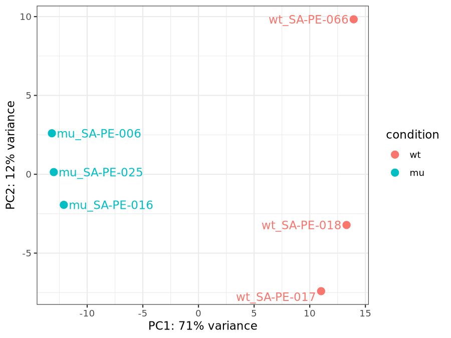
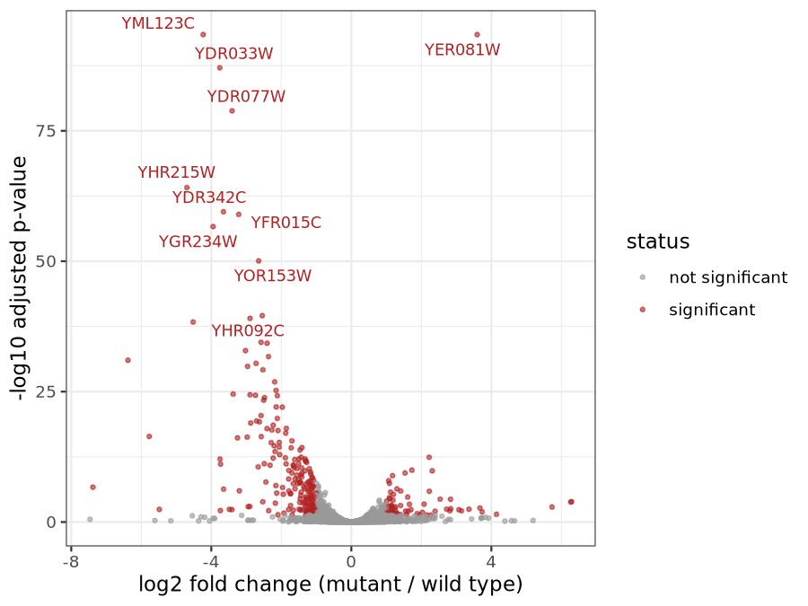

# From raw reads to differential expression: a reproducible RNA-seq workflow (yeast, WT vs *snf2*)

<p>


</p>

A small Snakemake workflow that goes from public FASTQ files to a differential-expression table, with one pinned conda environment per rule.

**Result in three lines**
- With 3 vs 3 biological replicates, DESeq2 finds **497 genes at adjusted p < 0.05** (144 up, 353 down in the *snf2* mutant); 276 of them also have |log2 fold change| > 1.
- Samples separate completely on PC1 (71% of variance).
- Positive control: the knocked-out gene itself (YOR290C, *SNF2*) is among the most strongly reduced genes (log2FC -6.4, adjusted p 9.5e-32).

## Question and data

Which genes change expression when the chromatin remodeller *SNF2* is deleted in yeast? The data are from the public 48-replicate yeast experiment (ENA project PRJEB5348; Gierliński et al. 2015, Schurch et al. 2016). I use 3 wild-type and 3 mutant replicates to keep the project small and fast.

No raw data is stored in this repository. The workflow downloads the six FASTQ files (about 550 MB) from ENA and checks each file's size against ENA's metadata.

## How the replicates were chosen

Each biological replicate in this dataset was sequenced across 7 lanes. The lanes are technical repeats, so treating them as separate samples would be pseudo-replication.

- ENA's sample aliases do not identify replicates: aliases are per run, and one run has a mislabelled alias.
- The **library ID** inside the submitted file names (`SA-PE-xxx`) does. It gives 48 libraries per condition, with 7 lanes each.
- I took one fixed lane (lane 3) for every sample, so lane cannot be confounded with condition. The 3 + 3 libraries were drawn at random with a fixed seed, excluding the library that contains the mislabelled run.
- `workflow/scripts/select_samples.sh` documents this. The committed `metadata/picked.tsv` and `config/samples.tsv` are the source of truth.

## What each step does

| Step | Tool | Plain-language purpose |
|---|---|---|
| Download | curl | Fetch the FASTQ files and verify the file sizes |
| QC | FastQC, MultiQC | Check read quality, adapters, duplication, GC content |
| Reference | Ensembl release 116 | Yeast transcripts plus the genome as "decoys" |
| Index | Salmon | Build a decoy-aware index, so reads from outside the annotated transcripts are less likely to be assigned to a gene by mistake |
| Quantify | Salmon | Estimate how many reads came from each transcript (library type auto-detected: unstranded) |
| Gene level | tximport | Summarise transcript estimates to genes (the transcript-to-gene table comes from the FASTA headers) |
| Statistics | DESeq2 | Test each gene for a difference between mutant and wild type; PCA on variance-stabilised counts; volcano plot |

Decisions based on the QC results:
- **No trimming.** Adapter content passed in all six samples; one adapter sequence made up about 0.06% of reads in two samples.
- Two FastQC modules (per-tile quality, per-base sequence content) were flagged in all six samples. This is a pattern I did not investigate further. Duplication was 29 to 42%, which is expected for RNA-seq.
- Salmon assigned 78.6 to 84.1% of reads in each sample, with no outlier and no pattern by condition.

DESeq2 settings: design `~ condition` with wild type as reference (positive log2FC means higher in the mutant); genes with fewer than 10 reads in total were removed (6,164 of 6,571 kept). The |log2FC| > 1 line on the volcano plot is a visual threshold, not part of the test.

## How to run

```bash
mamba env create -f environment.yaml
mamba activate rnaseq-smk
snakemake -c2 --software-deployment-method conda
```

Put the `--software-deployment-method` flag **after** any target names, because it accepts a list of values. The first run downloads the data and builds the conda environments. With the FASTQ files and environments already cached, the workflow rebuilds everything from raw reads to the DE table in about 2 minutes on a laptop with 6 GB of RAM, and gives identical numbers.

Main outputs: `results/multiqc/multiqc_report.html`, `results/deseq2/de_results.tsv`, `results/deseq2/pca.png`, `results/deseq2/volcano.png`.

## Tool versions (pinned in `workflow/envs/`)

| Tool | Version |
|---|---|
| Snakemake | 9.27.1 |
| curl | 8.23.0 |
| FastQC | 0.13.0 |
| MultiQC | 1.35 |
| Salmon | 2.11.0 |
| R | 4.5.3 |
| DESeq2 | 1.50.2 |
| tximport | 1.38.2 |

## Repository layoutconfig/ config.yaml, samples.tsv (the 6 chosen samples)
metadata/ ENA run tables and the seeded sample selection
workflow/ Snakefile, rules/, envs/, scripts/
docs/figures/ result figures used in this README
## Limitations

- **Only 3 vs 3 replicates.** Power is low. Schurch et al. (2016) found that with three replicates most tools recovered only about 20 to 40% of the DE genes found with 42 clean replicates, so many real changes are missed here.
- **One lane per sample,** so these libraries are shallower than the full data (1.3 to 2.3 million reads each).
- **41 genes are missing from the results.** Salmon keeps one transcript from each group of identical sequences, and the 41 dropped transcripts get no counts.
- **407 low-count genes were filtered out** before testing, and 2 more received no adjusted p-value.
- **The annotation is newer** than the one used in the original study, so gene models differ slightly.
- **About 16 to 21% of reads were not assigned** to a transcript, and I did not investigate why.
- **PC2 (12% of variance) is unexplained;** it spreads the wild-type replicates more than the mutants. I did not test whether it is biological or technical.
- I did not check my replicate choice against the original study's list of low-quality replicates.

## References

- Gierliński et al. (2015). Statistical models for RNA-seq data derived from a two-condition 48-replicate experiment. *Bioinformatics* 31(22):3625-3630.
- Schurch et al. (2016). How many biological replicates are needed in an RNA-seq experiment and which differential expression tool should you use? *RNA* 22(6):839-851.
